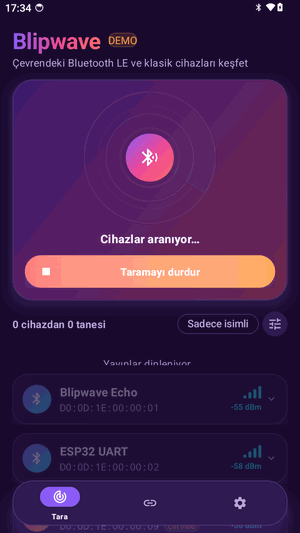
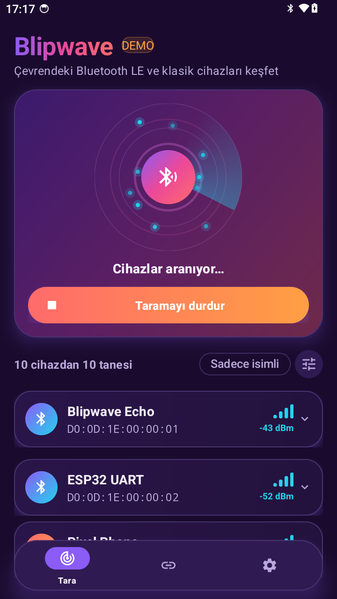
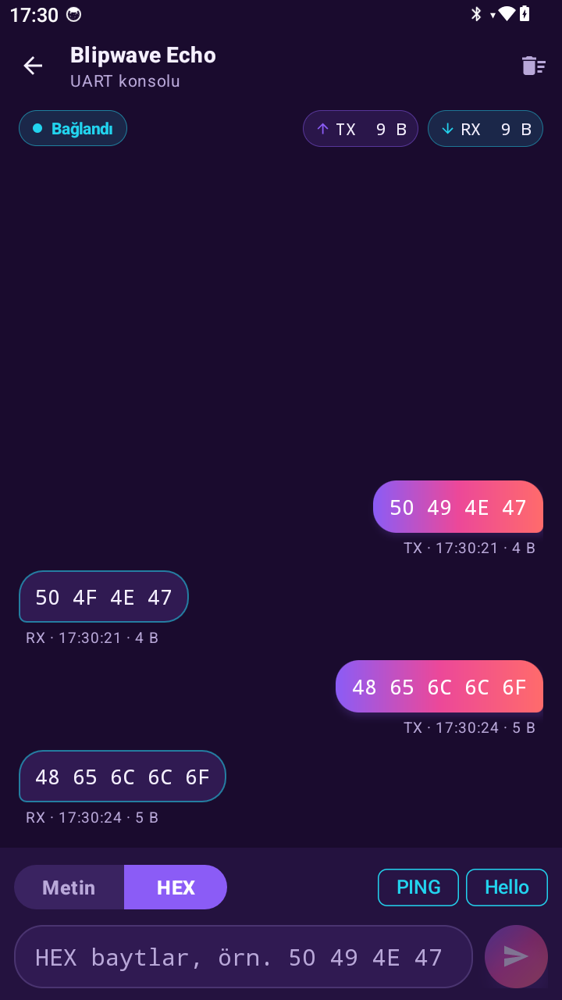
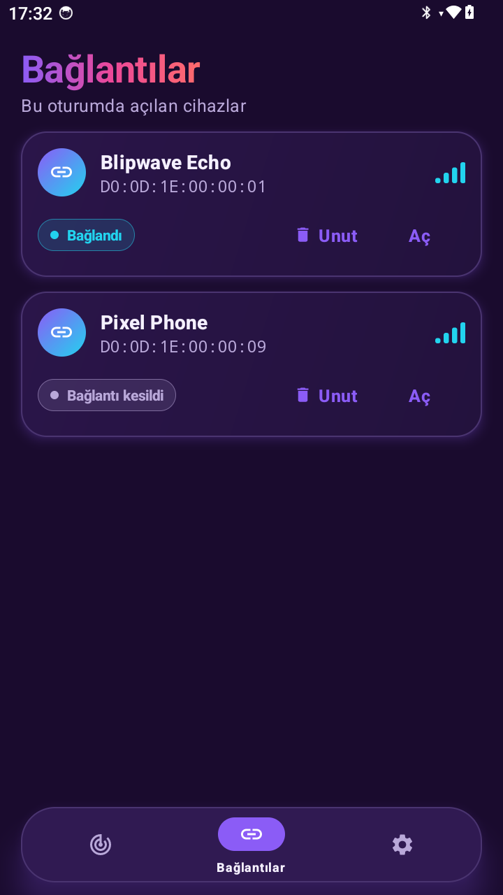
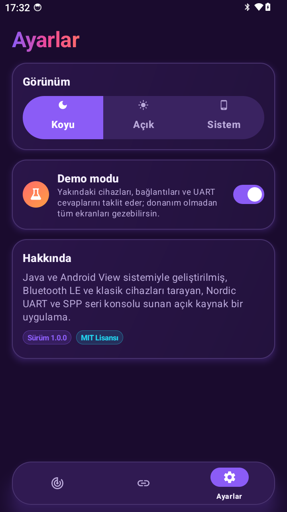
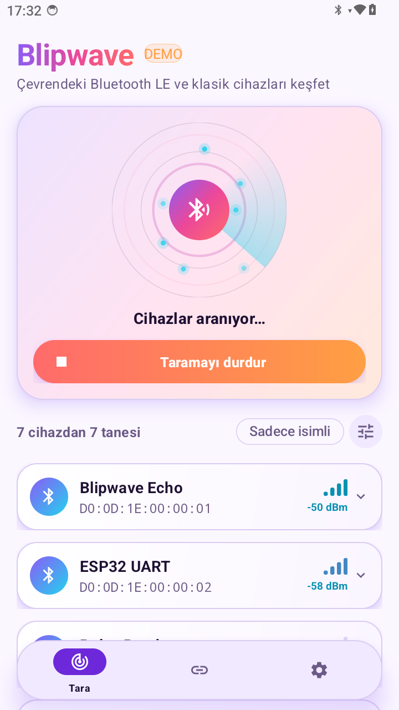
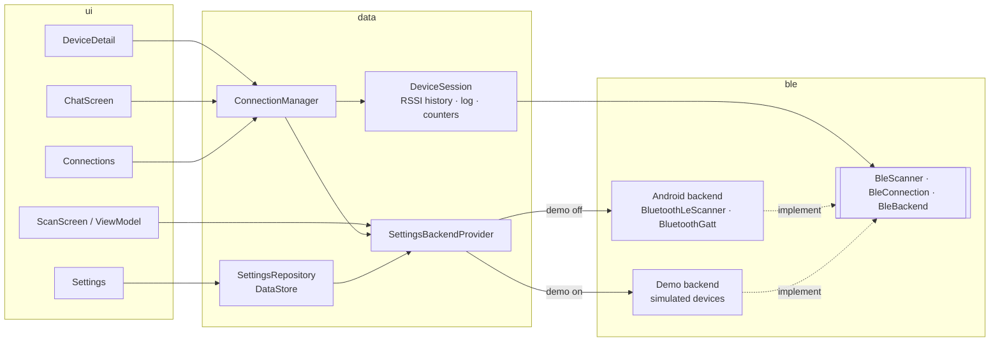

<div align="center">

# Blipwave

**A bold, animated Bluetooth LE scanner and Nordic UART console for Android.**

Scan nearby devices on a pulsing radar, inspect GATT services, watch live signal strength
and chat with your hardware over UART — or explore everything in demo mode, no hardware needed.


<!-- Demo video / GIF -->


</div>

---

## Screenshots

| Scan | Device detail | UART console |
|:---:|:---:|:---:|
|  |  |  |

| Connections | Settings | Light theme |
|:---:|:---:|:---:|
|  |  |  |

> Screenshots live in `docs/media/`. Demo mode is the easiest way to capture them.

## Features

### Scan
- **Radar animation** — expanding pulse rings, a rotating sweep beam and twinkling blips for every device found.
- **Animated device cards** that spring into the list, showing name, MAC address and RSSI.
- **Colour-coded signal bars** (cyan → violet → orange → coral) that animate as the signal changes.
- **Filters & sorting** — named devices only, minimum RSSI slider, sort by signal / name / last seen.
- Devices that stop advertising for 10 s are removed automatically.

### Device detail
- **Connection orb** with distinct states: spinning arc while *Connecting*, a glowing ring when *Connected*, a dashed coral ring when the link is *Lost*.
- **GATT browser** — services and characteristics with friendly names for standard UUIDs and READ / WRITE / NOTIFY badges.
- **Live RSSI chart** drawn with Compose `Canvas`: a smooth gradient line over a scrolling 60-second window.

### UART console
- Talks to the **Nordic UART Service** (`6E400001-B5A3-F393-E0A9-E50E24DCCA9E`).
- Chat bubbles — **TX on the right, RX on the left** — with timestamps and per-message byte counts.
- **Text / HEX toggle** that re-renders the whole log; HEX input accepts `50 49`, `50:49`, `0x50,0x49` or `5049`.
- Animated **TX / RX byte counters**, quick-send chips and MTU-aware chunked writes.

### Demo mode
A complete simulated backend: seven fake devices with drifting RSSI, realistic connection delays,
echo replies (`PING` → `PONG`), a sensor that sends periodic telemetry and a "flaky" device that drops
its link after 20 seconds. Perfect for README videos, emulators and UI testing.

### And also
- Dark theme by default, plus light and system themes.
- Floating pill-shaped bottom navigation with animated tab expansion.
- Adaptive launcher icon (including a themed/monochrome layer) and Android 12+ splash screen.
- English UI with a full Turkish translation.

## Design

| Token | Colour | Usage |
|---|---|---|
| Night | `#1A0B2E` | Dark background |
| Electric violet | `#8B5CF6` | Primary |
| Coral | `#FF6B6B` | Secondary, warnings, lost connections |
| Hot pink → sunset orange | `#EC4899` → `#FF9F43` | Warm gradients |
| Neon cyan | `#22D3EE` | Accent, strong signal, live data |

Gradients, soft coloured shadows and large rounded corners are shared through a small
`BlipTheme` extension on top of Material 3.

## Architecture



- **MVVM + StateFlow**, dependency injection with **Hilt**.
- The UI only sees the `BleScanner` / `BleConnection` / `BleBackend` interfaces, so the real and demo
  backends are interchangeable at runtime.
- `ConnectionManager` owns one `DeviceSession` per device, so the detail screen, the console and the
  Connections tab share the same connection, message log and RSSI history.
- Pure logic (scan merging/filtering, Text/HEX codec, RSSI window) lives in plain Kotlin objects that are easy to unit test.

```
app/src/main/java/dev/blipwave/
├── ble/          # contracts, models, Android & demo backends, Nordic UART UUIDs
├── data/         # settings, sessions, ConnectionManager, payload codec
├── di/           # Hilt modules
└── ui/           # theme, shared components, scan / device / chat / connections / settings
```

## Getting started

### Requirements
- Android Studio Ladybug (2024.2) or newer, JDK 17
- An Android device with Bluetooth LE (Android 8.0+), **or** an emulator with demo mode on

### Build & run
```bash
git clone https://github.com/<your-username>/blipwave.git
cd blipwave
./gradlew installDebug
```

On first launch, grant the **Nearby devices** permission (Android 12+) or **Location** (Android 11 and
below — required by the platform for BLE scanning). If you deny it, the app explains why it is needed
and offers demo mode instead.

### Try it without hardware
Open **Settings → Demo mode**, go back to **Scan** and press **Start scan**.

### Try it with an ESP32
The [`firmware/esp32_uart`](firmware/esp32_uart) sketch turns any ESP32 into a Nordic UART echo device
(`PING` → `PONG`). Flash it, scan for **Blipwave-ESP32**, connect and open the UART console.

## Testing

```bash
./gradlew testDebugUnitTest
```

59 JVM unit tests cover scan result merging, pruning, filtering and sorting; the Text/HEX codec;
device sessions (TX/RX logging, byte counters, RSSI window); `ConnectionManager` lifecycle;
the demo backend's connection states and replies; and `ScanViewModel` behaviour — all using
virtual time from `kotlinx-coroutines-test`.

## Tech stack

Kotlin 2.0 · Jetpack Compose · Material 3 · Navigation Compose · Hilt · Coroutines & Flow ·
DataStore · Core SplashScreen · JUnit 4 · kotlinx-coroutines-test

## License

Released under the [MIT License](LICENSE).
