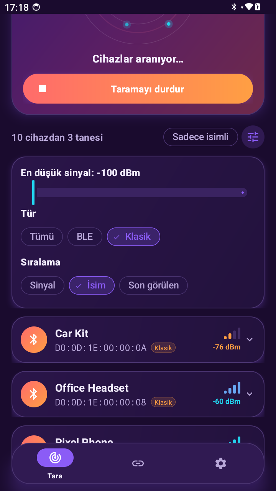
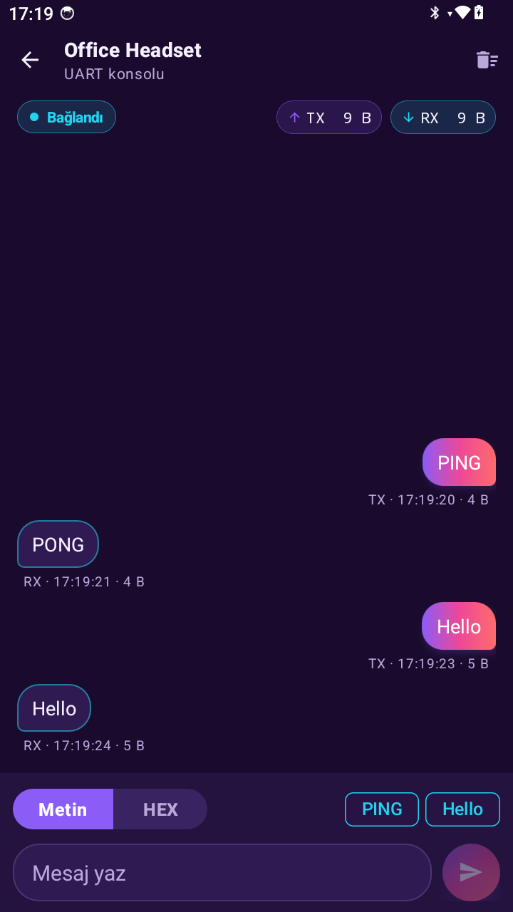
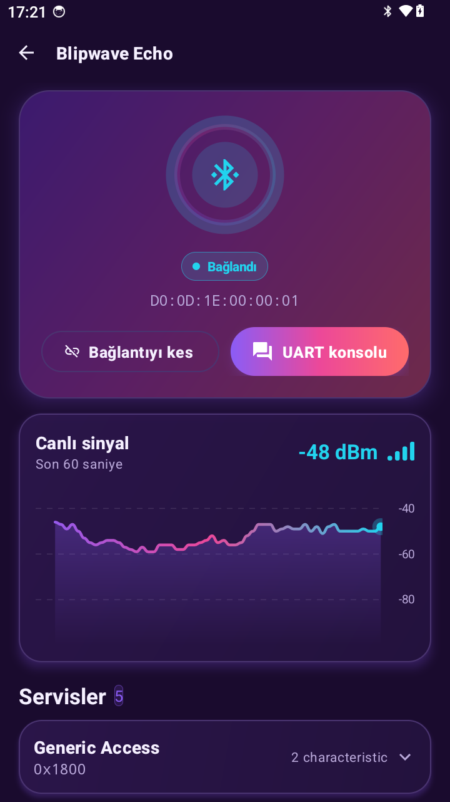
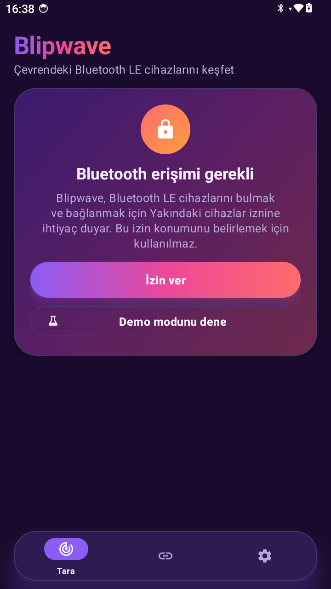
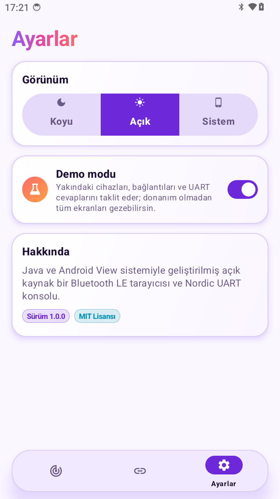
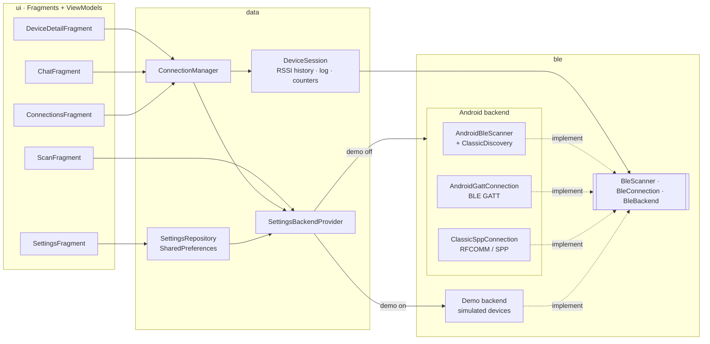

<div align="center">

# Blipwave

**A bold, animated Bluetooth scanner (LE + classic) and serial console for Android.**

Scan nearby devices on a pulsing radar, inspect GATT services, watch live signal strength and talk to
your hardware over **Nordic UART (BLE)** or **Serial Port Profile (classic Bluetooth)** — or explore
everything in demo mode, no hardware needed.


<!-- Demo video / GIF -->


</div>

---

## Screenshots

### Demo mode

| Scan | Device detail | UART console |
|:---:|:---:|:---:|
|  |  |  |

| Connections | Settings | Light theme |
|:---:|:---:|:---:|
|  |  |  |

### Tested on a real Android 14 handheld

| Live scan | Classic filter | SPP console |
|:---:|:---:|:---:|
|  |  |  |

| Device detail | Permission screen | Light theme |
|:---:|:---:|:---:|
|  |  |  |

> Screenshots live in `docs/media/` (demo mode) and `docs/media/pda/` (real hardware, 720×1280).
> When capturing on real hardware, prefer demo mode or blur nearby device names and MAC addresses.

## Features

### Scan
- **Radar animation** — expanding pulse rings, a rotating sweep beam and twinkling blips for every device found.
- **Animated device cards** that slide into the list, showing name, MAC address and RSSI; tap to expand.
- **Colour-coded signal bars** (cyan → violet → orange → coral) that animate as the signal changes.
- **BLE + classic Bluetooth at once** — the BLE scan and classic discovery (`startDiscovery`) run side by side.
  Classic devices get an orange avatar, a *Classic* tag and their device class (Audio, Phone, Computer…);
  devices seen by both scans are marked *Dual mode*.
- **Filters & sorting** — All / BLE / Classic, named devices only, minimum RSSI slider, sort by signal / name / last seen.
- Devices that disappear are pruned automatically: 10 s for BLE, 30 s for classic-only devices
  (classic discovery runs in ~12 s rounds).

### Connecting
| Device type | Transport | What you get |
|---|---|---|
| BLE / dual mode | GATT over LE | Services & characteristics, live RSSI chart, Nordic UART console |
| Classic only | RFCOMM socket, **Serial Port Profile** (`00001101-0000-1000-8000-00805F9B34FB`) | Serial console (secure socket first, insecure fallback); Android shows its pairing dialog when needed |

Classic discovery is cancelled before every connection attempt, because a running inquiry slows down
or breaks both GATT and RFCOMM connections.

### Device detail
- **Connection orb** with distinct states: spinning arc while *Connecting*, a glowing ring when *Connected*,
  a dashed coral ring when the link is *Lost*.
- **GATT browser** — services and characteristics with friendly names for standard UUIDs and
  READ / WRITE / NOTIFY badges. Classic links show a single *Serial Port Profile* entry.
- **Live RSSI chart** drawn on a custom `View` with `Canvas`: a smooth gradient line over a scrolling
  60-second window. Hidden for classic links, which cannot report RSSI.

### Serial console
- Same chat UI for **Nordic UART** (BLE) and **SPP** (classic).
- Chat bubbles — **TX on the right, RX on the left** — with timestamps and per-message byte counts.
- **Text / HEX toggle** that re-renders the whole log; HEX input accepts `50 49`, `50:49`, `0x50,0x49` or `5049`.
- Animated **TX / RX byte counters**, quick-send chips and MTU-aware chunked writes on BLE.
- SPP is a byte stream: a long reply may arrive in several chunks and is shown as several RX bubbles.

### Demo mode
A complete simulated backend: ten fake devices — including two classic-only devices and one dual-mode
phone — with drifting RSSI, realistic connection delays, echo replies (`PING` → `PONG`) over both UART and
SPP, a sensor that sends periodic telemetry and a "flaky" device that drops its link after 20 seconds.
Perfect for README videos, emulators and UI testing.

### And also
- Dark theme by default, plus light and system themes (`AppCompatDelegate` night modes).
- Floating pill-shaped bottom navigation that slides away on detail screens.
- Adaptive launcher icon (including a themed/monochrome layer) and Android 12+ splash screen.
- English UI with a full Turkish translation.

## Design

| Token | Colour | Usage |
|---|---|---|
| Night | `#1A0B2E` | Dark background |
| Electric violet | `#8B5CF6` | Primary |
| Coral | `#FF6B6B` | Secondary, warnings, lost connections |
| Hot pink → sunset orange | `#EC4899` → `#FF9F43` | Warm gradients, classic devices |
| Neon cyan | `#22D3EE` | Accent, strong signal, live data |

Colours are theme-aware resources (`values/colors.xml` for light, `values-night/colors.xml` for dark) feeding a
`Theme.Material3.DayNight` theme. Gradients, pill buttons and cards are XML drawables (`btn_brand`,
`bg_card_hero`, `bg_bubble_tx`…), and coloured shadows use `outlineSpotShadowColor` on API 28+.

## Architecture



- **MVVM + LiveData**: each screen is a `Fragment` with a Hilt `ViewModel`; navigation uses the Navigation
  Component (`res/navigation/nav_graph.xml`) and dependency injection uses **Hilt**.
- **XML + View Binding** for every screen and list item; lists use `RecyclerView` with `ListAdapter`/`DiffUtil`.
- **Custom views** under `ui/components`: `PulseRadarView`, `SignalBarsView`, `ConnectionOrbView`,
  `RssiChartView` and `StatusPillView`, all drawn on `Canvas` and animated with `ValueAnimator`.
- The UI only sees the `BleScanner` / `BleConnection` / `BleBackend` interfaces. GATT and SPP connections
  implement the same `BleConnection` contract, so the console works unchanged on both transports, and the
  real and demo backends are interchangeable at runtime.
- `ConnectionManager` owns one `DeviceSession` per device, so the detail screen, the console and the
  Connections tab share the same connection, message log and RSSI history.
- The core layer is plain Java with no Android dependencies: state is exposed through a tiny `ObservableValue`,
  bridged to `LiveData` in the ViewModels, and time comes from an injectable `Scheduler`/`Clock` so tests can
  drive a virtual clock instead of sleeping.
- Blocking socket I/O (SPP connect, read loop, writes) runs on background threads; every Bluetooth callback
  is posted to the main thread before it touches state.

```
app/src/main/
├── java/dev/blipwave/
│   ├── ble/          # contracts, models, scan filtering, Nordic UART & SPP UUIDs
│   │   ├── android/  # BLE scanner, classic discovery, GATT and SPP connections
│   │   └── demo/     # simulated devices and connections
│   ├── data/         # settings, sessions, ConnectionManager, payload codec
│   ├── di/           # Hilt modules
│   ├── ui/           # fragments, view models, adapters and custom views
│   └── util/         # ObservableValue, Scheduler, Clock, LiveData bridge
└── res/
    ├── layout/       # fragment_*.xml, item_*.xml
    ├── drawable/     # gradients, cards, bubbles, vector icons
    ├── navigation/   # nav_graph.xml
    └── values(-night|-tr)/  # colours, themes, strings
```

## Getting started

### Requirements
- Android Studio Jellyfish (2023.3) or newer (AGP 8.4), JDK 17
- An Android device with Bluetooth (Android 8.0+), **or** an emulator with demo mode on

### Build & run
```bash
git clone https://github.com/<your-username>/blipwave.git
cd blipwave
./gradlew installDebug
```

On first launch, grant the **Nearby devices** permission (Android 12+) or **Location** (Android 11 and
below — required by the platform for Bluetooth scanning). The same permissions cover BLE scanning,
classic discovery and both connection types. If you deny them, the app explains why they are needed and
offers demo mode instead.

### Try it without hardware
Open **Settings → Demo mode**, go back to **Scan** and press **Start scan**.

### Try it with an ESP32 (BLE)
The [`firmware/esp32_uart`](firmware/esp32_uart) sketch turns any ESP32 into a Nordic UART echo device
(`PING` → `PONG`). Flash it, scan for **Blipwave-ESP32**, connect and open the UART console.

### Try it with a classic Bluetooth serial module (SPP)
Any classic module that exposes the Serial Port Profile works (generic Bluetooth-to-UART boards, printers,
data loggers). Power it on, open **Filters → Classic**, tap the device, then **Connect**. Accept the pairing
request if Android asks for one, open the **UART console** and send text or HEX bytes.

## Testing

```bash
./gradlew testDebugUnitTest
```

72 JVM unit tests cover scan result merging (including LE + classic → dual mode), pruning, transport
filtering and sorting; the Text/HEX codec; device sessions (TX/RX logging, byte counters, RSSI window);
`ConnectionManager` lifecycle and BLE-vs-SPP connection requests; the demo backend's connection states,
classic devices and replies over UART and SPP; and `ScanViewModel` behaviour — all using a virtual-time
`FakeScheduler` and `InstantTaskExecutorRule` for LiveData.

## Tech stack

Java 17 · Android Views (XML + View Binding) · custom `View`s with `Canvas` · Material Components 3 ·
Fragments · Navigation Component · LiveData & ViewModel · Hilt · Bluetooth LE (GATT) · classic Bluetooth
(RFCOMM / SPP) · SharedPreferences · Core SplashScreen · JUnit 4 · AndroidX Arch Core Testing

## License

Released under the [MIT License](LICENSE).
